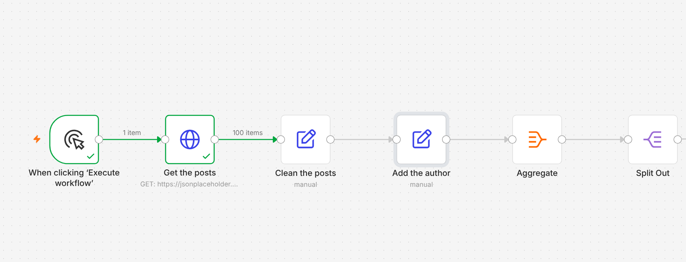

# Items and Data Structures (n8n)

A practice workflow that shows how data moves between nodes in n8n. It fetches 100 blog posts from a free test API, cleans every one of them with no loop, builds a new field with an expression, reaches back to an earlier node, then squeezes all 100 items into one list and splits them out again. Built in the Selwyn Builds tutorial **"n8n Items and Data Structures Explained"**, part of the free n8n Full Course for Beginners.

Watch it here https://youtu.be/AyktmkQlor8



## What it does

| Node | What it does |
|---|---|
| When clicking 'Execute workflow' | Manual trigger for testing |
| Get the posts (HTTP Request) | GET https://jsonplaceholder.typicode.com/posts, returns 100 items |
| Clean the posts (Edit Fields) | Keeps `post_id`, `post_title` and builds `summary` |
| Add the author (Edit Fields) | Reads `userId` from an earlier node with `$('Get the posts').item.json.userId` |
| Aggregate | Turns 100 items into 1 item with a list of titles |
| Split Out | Turns that list back into 100 items |

## Expressions to try

```
{{ $json.title }}
Post {{ $json.id }}: {{ $json.title.toUpperCase() }}
{{ $('Get the posts').item.json.userId }}
{{ $json.address.city }}
```

## Setup

1. Create a new workflow, open the menu at the top right, choose **Import from File**, and pick `workflow.json`.
2. Click **Execute workflow**. No credentials are needed, JSONPlaceholder is a free fake API made for practice.
3. Open each node and compare the input and output panels.

## Tips

- Every node sends out a list of items, and each item keeps its data in `json`.
- If an expression shows `undefined`, check the path and the field name case, and drag fields in instead of typing them.
- Pin data on the HTTP Request output while you build, and add a Limit node to test with 5 items.

Made by [Selwyn Builds](https://selwynbuilds.com).
