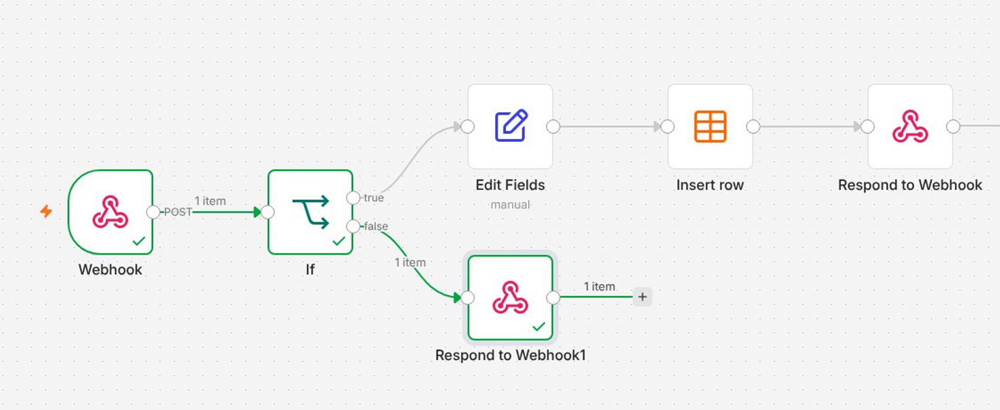

# Webhook Waitlist Signup (n8n)

A website waitlist form sends each signup to an n8n webhook. n8n checks the email, saves the signup to a data table, and replies right away with a personal thank you. Bad data gets a 400 error, and the webhook is locked with header auth. Built in the Selwyn Builds tutorial **"n8n Webhooks Explained (Catch Data From Any App)"**, episode 5 of the free n8n Full Course for Beginners.

Watch it here https://youtu.be/GAib06bQqQA

## What it does

- **Webhook** listens for POST requests on the path `waitlist`, protected with header auth, and responds using a Respond to Webhook node.
- **If** checks that the email in the body contains the at sign.
- **Edit Fields** keeps just `name` and `email` from the body.
- **Insert row** saves the signup to a data table, mapped automatically.
- **Respond to Webhook** sends back JSON, `{"message": "Thanks Selwyn, you're on the list."}`, using the saved name.
- **Respond to Webhook1** answers bad data with code 400 and `{"message": "Please enter a valid email."}`.

## Nodes used

| Node | What it does |
|---|---|
| Webhook | POST on `waitlist`, header auth, respond using Respond to Webhook node |
| If | Email contains @ |
| Edit Fields | name and email from the body |
| Insert row (Data table) | Insert, map automatically |
| Respond to Webhook | JSON reply with the name |
| Respond to Webhook1 | Response code 400 with an error message |

## Setup

1. Create a data table called **Waitlist** with the text columns `name` and `email`.
2. Import `workflow.json` with **Import from File**.
3. Open **Insert row** and select your **Waitlist** table.
4. Open **Webhook**, create a **Header Auth** credential with a header name such as `x-api-key` and a long secret value.
5. Click **Listen for test event** and send a test request to the test URL, for example
   `curl -X POST <your test URL> -H 'x-api-key: <your secret>' -H 'Content-Type: application/json' -d '{"name":"Selwyn","email":"selwyn@example.com"}'`
6. When it works, click **Publish** and use the production URL.

## Credentials you need to add

- **Header Auth** for the webhook. Only send the secret from a server or another app, never from website code.

## Tips

- Only one webhook can use the same path and method.
- The test URL catches one request per click on listen. A 404 that says the webhook is not registered means you need to click listen again, or use the production URL.
- If the workflow is slow, respond immediately and do the slow work after.

Made by [Selwyn Builds](https://selwynbuilds.com). Free course and community https://whop.com/selwyn-builds/
