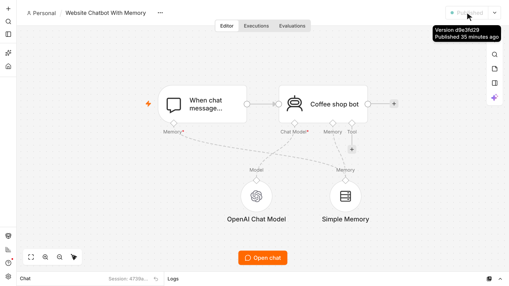

# Website AI Chatbot With Memory (n8n)

An AI chatbot that remembers every visitor's conversation and runs on any website with a few lines of code. Built in the Selwyn Builds tutorial **"Build an AI Chatbot in n8n With Memory"**.

Watch it here https://youtu.be/qDNQpMm2jcI

## What it does

- A visitor opens the chat bubble on your website and asks a question.
- An AI agent answers using the facts and rules in its system message (the example is a coffee shop called Bean There).
- Simple Memory keeps each visitor's conversation, so the bot remembers their name and what they asked earlier.
- When the visitor reloads the page, their previous messages come back.

## Nodes used

| Node | What it does |
|---|---|
| When chat message received (Chat Trigger) | Receives messages from the website chat. Mode is Embedded Chat, with Allowed Origins and Load Previous Session set to From Memory |
| AI Agent (Coffee shop bot) | Writes the replies. The system message holds the shop facts and 3 rules |
| OpenAI Chat Model | The language model the agent uses |
| Simple Memory | Stores the conversation per session. Context Window Length is 10 |

## Setup

1. In n8n, create a new workflow, open the menu at the top right, choose **Import from File**, and pick `workflow.json`.
2. Open **OpenAI Chat Model**, create or select your OpenAI credential, and pick a small, fast model from the list.
3. Open **Coffee shop bot** and replace the system message with your own business facts and rules.
4. Open **When chat message received**:
   - Copy the **Chat URL** at the top.
   - Change **Allowed Origins (CORS)** to your website address, for example `https://yourdomain.com`.
5. Click **Publish**. Embedded chat only works on a published workflow.
6. Paste the snippet from `embed-snippet.html` right before the closing `</body>` tag of your website, and replace `YOUR_CHAT_URL` with the Chat URL you copied.
7. Reload your website. The chat bubble appears in the bottom right corner.

## Credentials you need to add

- **OpenAI** (or any OpenAI compatible provider, by changing the Base URL in the credential).

No other logins are needed.

## Customize the chat window

The snippet already shows a custom title, subtitle, greeting and brand colors. Change the `i18n` text, the `initialMessages`, and the CSS variables (`--chat--color--primary`, `--chat--header--background`) to match your site.

## Before using it with real customers

- Simple Memory lives inside n8n. When n8n restarts, every conversation is gone. For production, swap it for **Postgres Chat Memory** or **Redis Chat Memory**.
- Simple Memory does not work if n8n runs in queue mode.
- Always set Allowed Origins, so only your site can use the chat.

Made by [Selwyn Builds](https://selwynbuilds.com).
